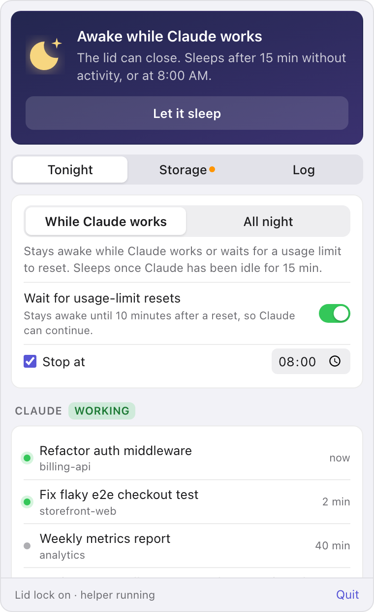

# Overnight

A macOS menu bar app that keeps a MacBook awake with the lid closed while Claude Code works. It lets the Mac sleep again once Claude is done or needs you, the battery runs low, the Mac gets hot, or your stop time comes.

**[Read the guide](https://dienp.github.io/overnight/)**

  

## Install

[Download the latest version](https://github.com/dienp/overnight/releases/latest/download/Overnight-macos.zip), open the zip and move Overnight to your Applications folder. It runs on macOS 12 or later, on Apple silicon and Intel Macs.

Overnight isn't notarized by Apple yet. The first time you open it, go to System Settings › Privacy & Security and click Open Anyway.

After that, Overnight opens when you log in and tells you when a new version is out. It installs one only when you click Update, or by itself if you turn on Install updates automatically. You can turn off either one in the popover.

## How it works

Only root can keep a MacBook awake with its lid closed, so Overnight asks for your password once a night and starts a small helper that exits when the night ends. Nothing is installed system-wide. Overnight reads Claude Code's session transcripts to tell when Claude is working, needs you, or is done, and it lets the Mac sleep below 10% battery or when it runs hot. Codex and Cursor sessions count too. [ARCHITECTURE.md](ARCHITECTURE.md) has the details.

A Mac kept awake in a bag gets hot, so leave it somewhere with airflow.

## Contributing

Report a problem through [GitHub issues](https://github.com/dienp/overnight/issues) or Report a Problem in the app's menu. To build Overnight yourself, see [CONTRIBUTING.md](CONTRIBUTING.md).
