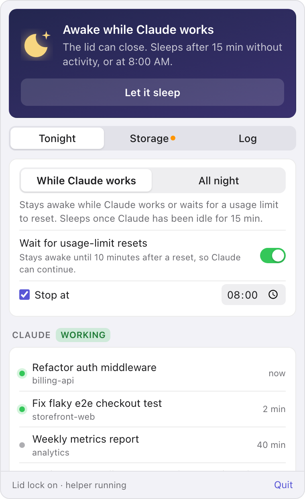

# Overnight

Overnight is a macOS menu bar app that keeps a MacBook awake with the lid closed while Claude Code works. It lets the Mac sleep again once Claude goes idle, the battery runs low, the Mac gets hot or your stop time comes.

[Read the documentation](https://dienp.github.io/overnight/), or report a problem through [GitHub issues](https://github.com/dienp/overnight/issues) or Report a Problem in the menu bar icon's menu. It runs on macOS 12 or later and is built with Tauri 2: Rust underneath, with a plain HTML, CSS and JavaScript popover.

<p align="center">
  
</p>

## What it does

Press Keep awake tonight before you close the lid. In While Claude works mode the Mac stays awake while your Claude Code sessions are busy or waiting for a usage limit to reset, then sleeps once Claude has been idle for 15 minutes. All night mode stays awake until your stop time, 8:00 AM by default. If you close the lid while Claude is already idle, the Mac sleeps right away.

On battery power, Overnight lets the Mac sleep once the charge drops below 10%, and it does the same if macOS reports that the Mac is running hot. You get a notification when that happens.

The popover lists your recent Claude sessions and says whether Claude is working, idle, paused on a usage limit, or stopped after one. When a session doesn't continue after its limit resets, Overnight says how to resume it and how to make Claude continue by itself next time.

The first time you open the popover after a run, it shows how the night went: how long Claude worked, how long the Mac was held awake, the battery change, how the run ended, and any sessions that need you.

Overnight can also:

- send its alerts to your phone through [ntfy](https://ntfy.sh)
- warn you when free disk space drops below 30 GB, measure what's taking the space, and hand the cleanup to Claude in Terminal, where you can watch it work
- keep a log of each night

## How it keeps the lid closed

Only root can stop a MacBook from sleeping when its lid closes (`pmset -a disablesleep 1`). When you press Keep awake tonight, macOS asks for your password once and Overnight starts a small root shell script, [helper.sh](src-tauri/src/helper.sh). For the rest of the night the app steers it through files in `~/Library/Application Support/dev.local.overnight/ctl/`. The script keeps the Mac awake while `hold` exists, and restores the original setting and exits when `release` appears. It writes its process ID to `pid` in the same folder.

The helper restores the original setting and exits as soon as the app quits or crashes. It lets the Mac sleep by itself at 8% battery, even if the app is stuck, and puts the hold back if something else turns sleep on again during the night.

Nothing is installed system-wide. There's no sudoers entry, launch daemon or kernel extension, and once the helper exits the Mac is back to normal.

## How Overnight decides Claude is working

Claude counts as working when a Claude Code process is running and one of two things is true: a session under `~/.claude/projects` recorded something within the idle time, or one session's process tree, including its builds, tests and tools, has used at least 20% of a CPU core for 15 seconds. Each session counts on its own, because a dozen idle sessions together can pass 20% while none of them is doing anything. Sessions in Terminal and in the Claude desktop app both count.

A recorded event is a timestamped record, such as a prompt, a reply, a tool result or a retry, or a write by one of the session's subagents. Overnight ignores the transcript file's modified time, because the Claude desktop app also appends untimed bookkeeping (titles, cost, artifact state) to sessions nobody is working in.

## Usage limits

Claude Code records a usage-limit stop in the session transcript in one of two ways. When the session gives up, it writes an assistant record with `"isApiErrorMessage": true, "error": "rate_limit"` and the reset time, in epoch seconds, in `quotaLimits.resetsAt`. When it waits for the reset and retries (this needs `CLAUDE_CODE_RETRY_WATCHDOG=1`), it writes a system `api_error` record with the reset time in `error.rateLimits.resetsAt`. A session counts as waiting until a normal reply follows.

Whether Claude continues by itself after the reset depends on these settings, which belong to Claude rather than Overnight:

| Where | Setting |
| --- | --- |
| Claude Code, `~/.claude/settings.json` | `"autoContinueAtUsageLimit"`, on unless set to `false` (Claude Code 2.1.234 or later) |
| The `env` block in `~/.claude/settings.json` | `"CLAUDE_CODE_RETRY_WATCHDOG": "1"` keeps retrying and waits until the reset |
| Claude desktop app, Code tab | The Auto-continue when limits reset checkbox on a session's usage-limit card |

The Claude Code docs cover [waiting for a usage limit to reset](https://code.claude.com/docs/en/interactive-mode.md#wait-for-a-usage-limit-to-reset) and the [autoContinueAtUsageLimit setting](https://code.claude.com/docs/en/settings-reference.md#autocontinueatusagelimit).

The Mac also has to be awake at the reset. A session that sleeps through it for more than about 30 minutes stops at "Press enter to continue". So in While Claude works mode, Overnight stays awake until 10 minutes after a pending reset. You can turn that off with Wait for usage-limit resets.

## Phone alerts

Turn on Send alerts to my phone and Overnight creates a random topic on ntfy.sh. Install the ntfy app on your phone, subscribe to the topic and press Send a test alert. On an iPhone, Copy topic name and Universal Clipboard save you typing it. Scanning a QR code doesn't work there, because the iPhone app doesn't open `ntfy://` links.

Alerts never name a session or project. Anyone who knows an ntfy.sh topic name can read it, so keep the random one or point Overnight at your own ntfy server. With Only when I'm away on, the default, alerts go to the phone only while the lid is closed or nobody has used the keyboard or mouse for 5 minutes. An alert that can't be sent is written to the log.

Claude's own phone notifications go through Remote Control, which some organizations turn off. These alerts don't depend on it.

## Install

[Download the latest version](https://github.com/dienp/overnight/releases/latest/download/Overnight-macos.zip), open the zip and move Overnight to your Applications folder. It runs on macOS 12 or later, on Apple silicon and Intel Macs. To start it at login, add it under System Settings › General › Login Items.

Overnight isn't notarized by Apple yet, so the first time you open it macOS says it can't check it for malicious software. Open System Settings › Privacy & Security and click Open Anyway next to Overnight. On macOS 14 and earlier you can Control-click the app and choose Open instead. You only do this once.

## Build it yourself

You need Node and Rust. If Rust came from Homebrew's `rustup`, which is keg-only, the npm scripts add it to your `PATH`.

```bash
npm install
npm run dev        # run with hot reload
npm run build      # makes src-tauri/target/release/bundle/macos/Overnight.app
```

If linking fails with `tapi` errors about an unknown architecture, the Command Line Tools linker on your `PATH` and the SDK `xcode-select` points at disagree. Create `src-tauri/.cargo/config.toml` to use the Command Line Tools for both. Git ignores that file, so it stays on your machine.

```toml
[env]
DEVELOPER_DIR = "/Library/Developer/CommandLineTools"
SDKROOT = "/Library/Developer/CommandLineTools/SDKs/MacOSX.sdk"
```

## Releases

Every push to `main` that changes the app, whether a merged pull request or a direct push, makes a release through [the release workflow](.github/workflows/release.yml). It works out the next version with `scripts/release-version.mjs`, runs the tests, builds a universal app for Apple silicon and Intel, ad-hoc signs it, and publishes `Overnight-macos.zip` on the [Releases page](https://github.com/dienp/overnight/releases). Then it commits the new version to `main` and tags it.

The version goes up by a patch number each time. Put `[minor]` or `[major]` in a commit message for a bigger step, or `[skip release]` to leave a push out. Changes that only touch `docs/` or Markdown files don't release. To see what the next version would be:

```bash
node scripts/release-version.mjs --dry-run
```

## Files

Overnight keeps everything in `~/Library/Application Support/dev.local.overnight/`:

| File | What it holds |
| --- | --- |
| `settings.json` | Your settings |
| `events.jsonl` | The log, trimmed to about 2 MB |
| `ctl/` | The helper's `hold`, `release` and `pid` files |
| `cleanup.command` | The Terminal script that Ask Claude to clean up runs |

## Tests and debugging

```bash
cd src-tauri && cargo test          # parsers, guards, summaries, phone alerts, the osascript launch command
sh scripts/test-helper.sh           # the root helper, with pmset and ioreg stubbed (no root needed)
src-tauri/target/debug/overnight --probe   # print live readings as JSON
```

To work on the popover without Tauri, serve `src/` (for example with `python3 -m http.server -d src`) and open `index.html`. It loads `preview-mock.js` in place of the backend. Query parameters choose the state: `state=off`, `on` or `standby`; `limit=waiting` or `missed`; `auto=off`; `phone=on`; and `theme=dark`.

`npm run icons` redraws the menu bar and app icons from `scripts/make-icons.py`.

## Resource use

Overnight reads the battery, the lid and the sleep setting in-process through IOKit and runs no commands on its regular checks. It checks every 10 seconds while it's keeping the Mac awake or the popover is open, and every 30 seconds otherwise. The popover's web page closes 3 seconds after the popover hides, which frees most of WebKit's memory. With the popover closed, the app uses around 20 to 30 MB. The root helper starts only `sleep` in its 5-second loop and checks the battery and the sleep setting every 30 seconds.

## Things to know

A Mac kept awake in a bag gets hot. The heat guard helps, but leave the Mac somewhere with airflow.

On a managed work Mac, check that your IT policy allows running `pmset` as an administrator.

Notifications ask for permission the first time the built app sends one. Under `npm run dev` they may appear under Terminal, or not at all.
